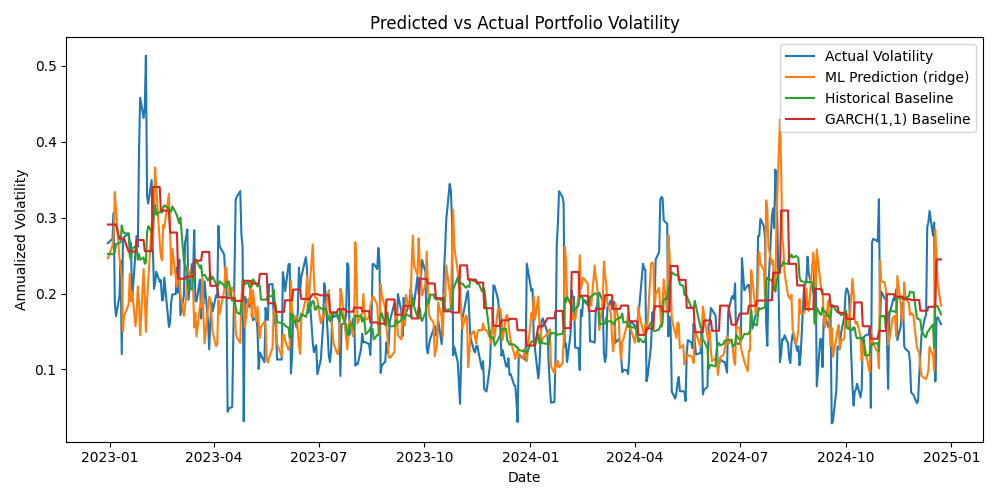

# Portfolio Risk Predictor

Portfolio volatility forecasting with machine learning, plus a quantitative risk engine for any set of tickers and weights. It covers VaR, Expected Shortfall, stress testing, risk decomposition and VaR backtesting. It ships with a FastAPI service, a Streamlit dashboard and a PDF report generator.



## Features

- **Volatility forecasting**: Ridge, RandomForest and GradientBoosting models predict 5-day-forward realized volatility. The best model is chosen on validation RMSE.
- **Baselines**: a 21-day rolling historical volatility and a rolling-refit GARCH(1,1).
- **Explainability**: feature importance and SHAP values.
- **VaR / Expected Shortfall**: historical, parametric (variance-covariance) and Monte Carlo (10,000 multivariate-normal draws).
- **Stress testing**: market crash, 2x volatility shock, correlation-to-0.9 shock and custom scenarios.
- **Risk decomposition**: marginal and component contribution to portfolio variance, summing to 100%.
- **Backtesting**: Kupiec proportion-of-failures test plus a breach log.
- **Performance metrics**: Sharpe, Sortino, Calmar, max drawdown, rolling VaR.
- **Delivery**: REST API, interactive dashboard and a multi-page PDF report.

## Architecture

```
Prices (yfinance) -> Returns / Covariance
                  -> Risk Engine   (Historical / Parametric / Monte Carlo VaR, ES)
                  -> Stress Engine (crash, vol shock, correlation shock, custom)
                  -> Backtesting   (VaR breaches, Kupiec test)
                  -> API / Dashboard / PDF report

Returns -> Features -> Chronological split -> Model selection -> Saved model
                                                              -> Compared with historical and GARCH baselines
```

## Project layout

| Path | Purpose |
|---|---|
| `data.py` | Price download (yfinance, with retries), asset and portfolio returns |
| `covariance.py` | Annualized covariance and correlation matrices |
| `var_engine.py` | Historical, parametric and Monte Carlo VaR / ES |
| `stress_engine.py` | Stress and scenario tests |
| `risk_decomposition.py` | Marginal and component risk contributions |
| `risk_metrics.py` | Volatility, VaR, CVaR, drawdown, ratios, Kupiec test, exception analysis |
| `risk_pipeline.py` | Runs the full risk engine; used by the API and dashboard |
| `features.py` | Lagged and rolling features, volatility target, chronological split |
| `models.py` | Model training and selection |
| `garch_baseline.py` | Rolling GARCH(1,1) baseline |
| `explainability.py` | Feature importance and SHAP |
| `report.py` | PDF report generation (reportlab) |
| `train.py` | End-to-end training and evaluation pipeline |
| `api.py` | FastAPI service |
| `app_streamlit.py` | Streamlit dashboard |
| `notebook.ipynb` | Exploratory walkthrough |
| `tests/` | Unit tests |
| `artifacts/` | Training outputs (`report.json`, feature importances; model and PDFs are generated) |
| `plots/` | Training and report charts |

## Getting started

Requires Python 3.12 (the pinned versions were developed on 3.12).

```bash
python -m venv .venv
# Windows: .venv\Scripts\activate    macOS/Linux: source .venv/bin/activate
pip install -r requirements.txt
```

### 1. Train (required before using the API or dashboard)

```bash
python train.py
```

This downloads prices (needs internet access), trains the models, and writes:
- `artifacts/best_model.joblib`: the trained model bundle
- `artifacts/report.json`: metrics, backtest results and importances
- `artifacts/reports/risk_report.pdf`: the PDF risk report
- `plots/`: charts

`api.py` and `app_streamlit.py` load `artifacts/best_model.joblib` on startup, so they fail until this step has run.

### 2. Run the API

```bash
uvicorn api:app --reload
```

Interactive docs are at http://127.0.0.1:8000/docs. Endpoints are `GET /health` and `POST` `/predict_volatility`, `/risk_metrics`, `/var`, `/covariance`, `/stress_test`, `/risk_decomposition`, `/backtest` and `/report` (returns a PDF).

Example request body:

```json
{
  "tickers": ["AAPL", "MSFT", "GOOGL", "AMZN", "SPY"],
  "weights": {"AAPL": 0.25, "MSFT": 0.25, "GOOGL": 0.2, "AMZN": 0.15, "SPY": 0.15},
  "lookback_days": 400,
  "confidence": 0.95
}
```

### 3. Run the dashboard

```bash
streamlit run app_streamlit.py
```

### 4. Run the tests

```bash
pytest
```

## Results

Default portfolio: AAPL 25%, MSFT 25%, GOOGL 20%, AMZN 15%, SPY 15%. Data runs from 2015-01-01 to 2025-01-01, with a chronological 60/20/20 train/validation/test split.

**Volatility forecast, test set** (lower is better):

| Model | MAE | RMSE |
|---|---|---|
| 21-day historical baseline | 0.0603 | 0.0763 |
| GARCH(1,1), rolling refit | 0.0620 | 0.0772 |
| Ridge (selected ML model) | 0.0621 | 0.0819 |

The ML model does **not** beat the simple historical baseline on this portfolio. Forecasting realized volatility from the portfolio's own return history is hard to improve on, and rolling-volatility features dominate the importance rankings. Treat the ML component as a framework for experimentation (new features, other assets, other targets), not a proven improvement.

**Portfolio risk, full sample:** annualized volatility 23.3%, 95% daily VaR 2.36%, 95% CVaR 3.46%, max drawdown -34.9%, Sharpe 1.09.

**VaR backtest:** 124 breaches in 2,264 observations (5.48% against an expected 5.00%). The Kupiec test does not reject the model (p = 0.30).

## Methodology

- **Target:** realized annualized volatility over the next 5 trading days.
- **Splits:** strictly chronological, to avoid look-ahead bias.
- **Historical VaR:** empirical percentile of portfolio returns.
- **Parametric VaR:** assumes normally distributed returns, using the portfolio covariance matrix.
- **Monte Carlo VaR:** 10,000 draws from a multivariate normal fit to asset returns.
- **Stress tests:** each scenario is measured against base portfolio volatility or loss.
- **Backtesting:** Kupiec likelihood-ratio test of the breach rate against the expected rate.

## Limitations

- Parametric and Monte Carlo VaR assume normal returns and understate tail risk when returns are fat-tailed.
- Data comes from Yahoo Finance via yfinance, which is unofficial and may rate-limit or change.
- Results are for the default portfolio and period. Past performance does not predict future risk.
- This is an educational and research project, not investment advice.
