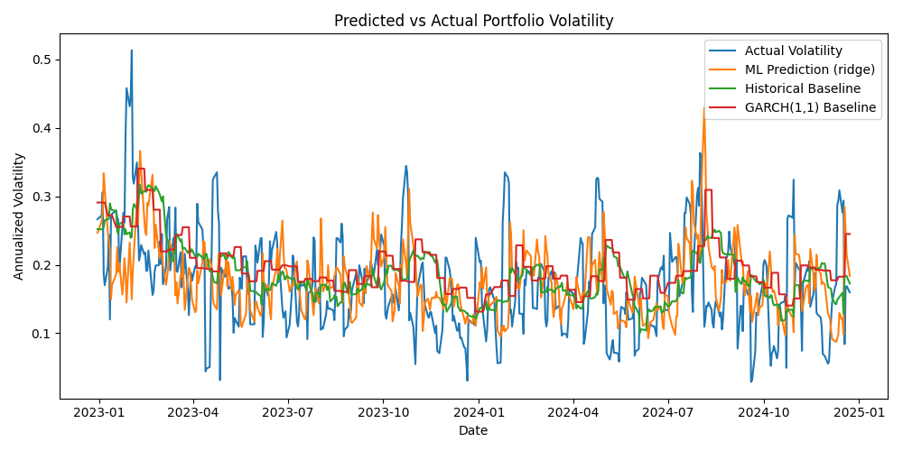
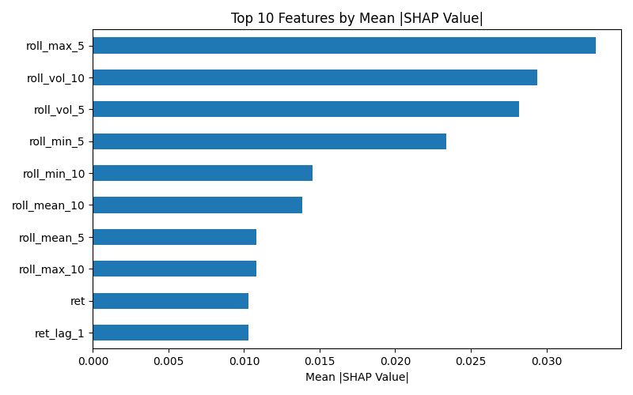

# Results

Output of a single run of `python train.py` (seeded; run on Python 3.12 with the pinned `requirements.txt`).
Raw numbers are in [`models/report.json`](models/report.json).

## Setup

| Item | Value |
|---|---|
| Assets / weights | AAPL 25%, MSFT 25%, GOOGL 20%, AMZN 15%, SPY 15% |
| Price data | Yahoo Finance (adjusted close), 2015-01-01 to 2025-01-01 (2,515 daily returns) |
| Target | Realized annualized volatility over the **next 5 trading days** |
| Features | 18 (return, 4 lags, rolling std / mean / min / max over 5, 10, 21 days, absolute return) |
| Split | Chronological 60 / 20 / 20 |

| Split | Rows | Dates | Mean target vol |
|---|---|---|---|
| Train | 1,494 | 2015-02-03 to 2021-01-07 | 0.188 |
| Validation | 498 | 2021-01-08 to 2022-12-29 | 0.245 |
| Test | 498 | 2022-12-30 to 2024-12-23 | 0.174 |

## Model selection (validation set)

| Model | MAE | RMSE |
|---|---|---|
| **Ridge (alpha=1)** | **0.0796** | **0.1046** |
| Gradient Boosting | 0.0818 | 0.1090 |
| Random Forest | 0.0817 | 0.1100 |

Ridge had the lowest validation RMSE and was selected.

## Test-set comparison

| Method | MAE | RMSE |
|---|---|---|
| Historical baseline (21-day rolling vol) | **0.0603** | **0.0763** |
| GARCH(1,1) baseline (refit every 5 steps) | 0.0620 | 0.0772 |
| ML model (Ridge) | 0.0621 | 0.0819 |

**The ML model does not beat either baseline on the test period.** The simple 21-day historical
volatility has the lowest error on both metrics, GARCH is close behind, and Ridge is last on RMSE
(about 7% worse than the historical baseline). Possible reasons:

- Volatility is highly persistent, and the 21-day rolling volatility already captures most of the signal.
- The features are all derived from the same return series, so the models have little information beyond what the baselines use.
- The validation window (2021-2022) was a high-volatility regime (mean 0.245), unlike train (0.188) and test (0.174), so selection on validation may not transfer to the test period.
- A single 5-day realized-vol target is noisy, which caps the achievable error for every method.

Differences between the methods are small and come from one test window, so they should not be
read as statistically significant either way.

## Explainability

Ridge uses |coefficient| for native importance. SHAP values come from the model-agnostic permutation explainer.

Top features by mean |SHAP| (full tables in `models/shap_importance.csv` and `models/feature_importance.csv`):

| Rank | Feature | Mean abs SHAP |
|---|---|---|
| 1 | `roll_max_5` | 0.0333 |
| 2 | `roll_vol_10` | 0.0294 |
| 3 | `roll_vol_5` | 0.0282 |
| 4 | `roll_min_5` | 0.0234 |
| 5 | `roll_min_10` | 0.0146 |

Short-window (5-10 day) volatility and extreme-return features dominate. Lagged single-day returns
contribute little.

## Full-period portfolio risk metrics (2015-2025)

| Metric | Value |
|---|---|
| Annualized volatility | 23.3% |
| VaR 95% (1-day, historical) | 2.36% |
| CVaR 95% (1-day, historical) | 3.46% |
| Max drawdown | -34.9% |
| Sharpe ratio (rf = 0) | 1.09 |
| Sortino ratio | 1.42 |
| Calmar ratio | 0.73 |

## VaR backtest (Kupiec proportion-of-failures test, 95%)

| Observations | Breaches | Breach rate | Expected | LR stat | p-value | Reject H0 (5%)? |
|---|---|---|---|---|---|---|
| 2,264 | 124 | 5.48% | 5.00% | 1.05 | 0.305 | No |

The rolling 252-day historical VaR is statistically consistent with its 95% target.

## Known limitations

- **Rolling VaR timing:** `rolling_var_series` includes the current day's return in its window, so
  the backtest VaR is not strictly out-of-sample. Shifting the series by one day (`.shift(1)`) would
  make it a proper one-day-ahead forecast. The Kupiec result above may be slightly optimistic.
- **Single run, single split:** no walk-forward / cross-validation, no confidence intervals.
- **GARCH alignment:** the GARCH forecast is the one-step-ahead conditional vol, while the target
  is the realized vol over the next 5 days, which slightly disadvantages GARCH.
- **Survivorship / concentration:** five large-cap US tech-heavy names over a bull-market decade.
- `EnsembleAverage` in `models.py` is defined but not used by `train.py`.
